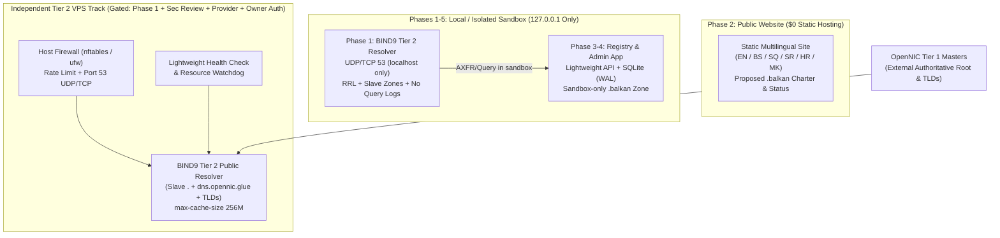

# System Architecture

> **Status:** Phase 0 Design Specification (No production services deployed; `.balkan` TLD is proposed only and not approved/delegated by OpenNIC).
> **Target Baseline:** `$0` initial budget; initial production VPS target `1 vCPU, 1 GB RAM, 15–20 GB SSD`.

## 1. Architectural Principles

1. **Compliance with OpenNIC Specifications:** Design DNS services around verified OpenNIC requirements (Slave Zone Method for public Tier 2, strict no-PII query logging, UDP/TCP port 53, DNSSEC trust anchors).
2. **Low-Memory Efficiency (`<= 1 GB RAM`):** Avoid memory-heavy runtimes (JVM, Elasticsearch, managed Redis clusters, multi-container microservices). Use single-node, low-footprint binaries and embedded SQLite (WAL mode).
3. **Strict Phase Isolation:** During Phases 1–5, all services run strictly in local/isolated sandbox networks (`127.0.0.1` or internal Docker bridges) with zero public port exposure.
4. **Static-First Public Web:** Offload the Phase 2 informational website completely to `$0` free-tier static hosting so zero VPS RAM/CPU/bandwidth is spent serving web pages.
5. **Reproducibility & Portability:** Containerized configurations with pinned base images, explicit resource caps, and automated CI validation.

---

## 2. High-Level Target Architecture

---

## 3. DNS Software Selection (Phase 1 Decision)

### Candidates Evaluated

| Criterion | **BIND9 (ISC BIND 9.18+ / 9.20)** | **Unbound** | **Knot DNS / NSD** |
| --- | --- | --- | --- |
| Public Tier 2 Slave Zone compliance (`zone "."` + `dns.opennic.glue` + TLDs) | **Native first-class support** (`type secondary` / AXFR/IXFR) | Recursive resolver; OpenNIC wiki only documents `root-hints` (discouraged for public Tier 2) | Authoritative-only (cannot serve recursive ICANN + OpenNIC Tier 2 queries alone) |
| OpenNIC documentation & tooling | Primary OpenNIC documented implementation (`t2slaved`, `srvzone`, `dnssec`, `bindlogconfig`) | Minimal wiki snippet (`tier_2_unbound`) | Not documented for OpenNIC Tier 2 |
| Built-in abuse mitigation | Response Rate Limiting (`rate-limit`), `minimal-responses`, `max-cache-size`, ACLs | `ip-ratelimit`, `ratelimit`, `minimal-responses` | Authoritative RRL only |
| DNSSEC with OpenNIC root | Supported via `trust-anchors` (`named.conf.keys`) + `dnssec-validation yes` | Supported via `auto-trust-anchor-file` | N/A for recursive validation |
| Footprint on `1 vCPU / 1 GB RAM` | ~120–300 MB RAM when bounded (`max-cache-size 256m`) | ~64–180 MB RAM | ~30–80 MB RAM (authoritative only) |

### Decision: **BIND9** for Phase 1 Tier 2 Resolver

- **Rationale:** OpenNIC explicitly states that public Tier 2 servers listed on `servers.opennic.org` **must** use the Slave Zone Method rather than `root-hints`. BIND9 directly implements OpenNIC's documented `secondary` zone model for `.`, `dns.opennic.glue`, and OpenNIC TLD zones, supports Response Rate Limiting (RRL) natively, supports explicit `max-cache-size` memory bounding for a 1 GB RAM host, and can also cleanly separate recursive Tier 2 vs. future authoritative Tier 1 roles (using separate containers/hosts when Phase 6/7 is authorized).
- **Root Synchronization Safety:** Rather than executing OpenNIC's legacy `srvzone` script over plaintext HTTP at runtime, Phase 1 will use a declarative, version-controlled zone list + verification script inside the repository, checked into Git and validated before reload.
- **DNSSEC Strategy:** Phase 1 will include a documented DNSSEC compatibility assessment comparing strict OpenNIC root `trust-anchors` validation against known non-signed or lagging peered/alternative zones to prevent widespread `SERVFAIL` regressions.

---

## 4. Phase 2 Public Website Architecture

- **Hosting:** `$0` static hosting (GitHub Pages or Cloudflare Pages free tier; no VPS runtime required).
- **Stack:** Lightweight static site generator or zero-JS-bloat HTML/CSS (e.g., Astro or Eleventy static output, finalized at Phase 2 start) with strict Content Security Policy, no tracking cookies, and no external ad/analytics scripts.
- **Visual Direction:** Minimal internet-infrastructure aesthetic — dark navy (`#0B192C` / `#0F172A`), crisp white surfaces, restrained blue accents (`#2563EB` / `#38BDF8`), WCAG 2.1 AA contrast, mobile-first layout.
- **Localization Architecture:** Six locales from day one using URL-prefixed static routes (`/en/`, `/bs/`, `/sq/`, `/sr/`, `/hr/`, `/mk/`) backed by structured JSON/YAML translation dictionaries and a CI completeness check ensuring fallback keys never break builds:
  - English (`en`)
  - Bosnian (`bs`)
  - Albanian (`sq`)
  - Serbian (`sr`)
  - Croatian (`hr`)
  - Macedonian (`mk`)
- **Required Guardrail:** Every page referencing `.balkan` must display an unmistakable status badge stating `.balkan` is **proposed and not yet approved or delegated by OpenNIC**.

---

## 5. Phases 3–4 Domain Registry & Admin Architecture (Sandbox-Only)

- **Design Goal:** Must coexist comfortably in sandbox tests and, if later co-located or separated, fit within minimal VPS memory (`<= 150 MB RAM` for API + DB).
- **Recommended Stack (to be finalized at Phase 3 kickoff):**
  - **Backend API & SSR/UI:** Single lightweight binary or minimal runtime (e.g., Go `net/http` + `html/template` or Python FastAPI + Jinja2), strictly free of heavy ORMs or paid external auth SaaS.
  - **Database:** Embedded **SQLite** in `WAL` mode (`PRAGMA foreign_keys = ON;`), stored on local volume with deterministic automated backups (`sqlite3 .backup` / atomic snapshots). Zero external database server RAM overhead.
  - **Authentication & RBAC:** Argon2id password hashing, HTTP-only `Secure`/`SameSite=Lax` session cookies, CSRF tokens, TOTP MFA for admin accounts (`admin`, `moderator`, `user` roles).
  - **Zone Generation Boundary:** Registry writes validated `.balkan` sandbox records to SQLite, exports deterministic RFC 1035 zone files, runs `named-checkzone` validation before atomic swap, and reloads only an **isolated sandbox authoritative instance** (never public DNS).
  - **Policy Constraints:** Strictly `$0` free registration, zero payment gateway code, reserved-name enforcement (`opennic.balkan`, `nic.balkan`, `www.balkan`, `localhost`, etc.), expiry/renewal lifecycle, abuse reporting queue, and immutable append-only audit log table.

---

## 6. Resource Budget for Target `1 vCPU / 1 GB RAM / 15–20 GB Storage` VPS

> Note: Any public deployment remains gated (no VPS provisioned yet). Tier 2 deployment becomes independently eligible after Phase 1 + dedicated Tier 2 security review + provider port-53 permission + VPS availability + explicit owner authorization, separate from Phase 7 `.balkan` TLD activation.

| Component | Target RAM Allocation | Target Disk Allocation | Notes |
| --- | --- | --- | --- |
| Linux OS + kernel + SSH + firewall (`nftables`/`ufw`) | ~180 MB | ~3.5 GB | Minimal Debian/Alpine/Ubuntu Server LTS, no desktop GUI |
| Container runtime (`dockerd` / `containerd` or rootless `podman`) | ~70 MB | ~2.0 GB | Pinned minimal images (`--memory` limits enforced) |
| BIND9 Tier 2 Resolver (`max-cache-size 256m`) | ~300 MB hard cap | ~1.0 GB | Slave zones + journal files; **query logging disabled** |
| Health checks / logrotate / system swap safety | ~50 MB | ~1.0 GB (swapfile) | 1 GB zram or swapfile as OOM cushion; `vm.swappiness=10` |
| **Unallocated Headroom** | **~400 MB** | **~7.5–12.5 GB** | Absorbs OS updates, zone spikes, and DDoS state tables |

### Architectural Separation Note for Future Tier 1 + Registry (Phase 6/7)

OpenNIC rules require Tier 1 servers to be **authoritative-only** (no public ICANN recursion) and Tier 2 servers to provide **public ICANN + OpenNIC recursion**. Serving both public roles on one IP/port 53 is incompatible, and running a public Tier 2 + Tier 1 + Registry + Mail (`hostmaster@`, `abuse@`, `webmaster@`) on a single 1 GB RAM VPS introduces severe blast-radius and memory contention risks. Therefore:
- **Phase 1–5:** Everything runs safely in local/isolated sandbox containers.
- **Independent Tier 2 Deployment Track (when authorized post-Phase 1):** Initial `1 vCPU / 1 GB RAM` VPS is scoped cleanly to the **Tier 2 Public Resolver**, allowing OpenNIC's mandatory 3-month continuous Tier 2 operational history to accumulate while Phases 2–4 are built.
- **Phase 7 (`.balkan` TLD activation, remains BLOCKED):** Tier 1 authoritative DNS and Registry hosting must be placed on separate isolated capacity or explicitly re-evaluated before Phase 6/7 authorization and OpenNIC community voting.
